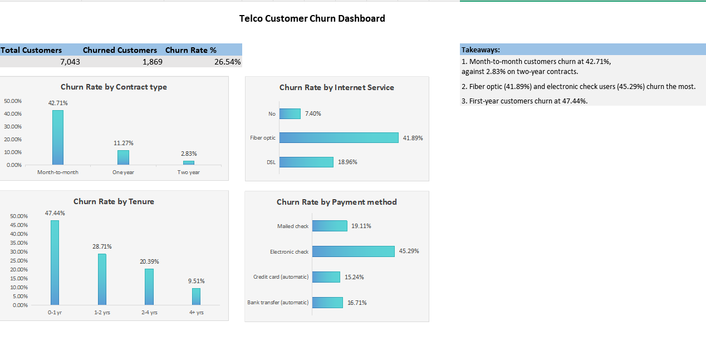

Telco Customer Churn Analysis (Excel)

Analysed which customers of a fictional telecom company leave, using Excel pivot tables and a dashboard.

Business question: Which customer groups churn the most, and what can the company do to keep them?

Data: Telco Customer Churn (IBM sample data on Kaggle), 7,043 customers and 21 columns.
https://www.kaggle.com/datasets/blastchar/telco-customer-churn

Top findings:
- 1,869 of 7,043 customers churned (26.54%).
- Month-to-month customers churn at 42.71%, against 2.83% on two-year contracts, and make up about 89% of all churn.
- First-year customers churn at 47.44%.
- Fiber optic (41.89%) and electronic check users (45.29%) churn the most, and the gaps hold within every contract type.

Files:
- Telco-Customer-Churn.xlsx: the workbook with the data, pivot tables and dashboard
- TELCO CUSTOMER CHURN ANALYSIS.pdf: the full report
- Dashboard_Telco.png: the dashboard

